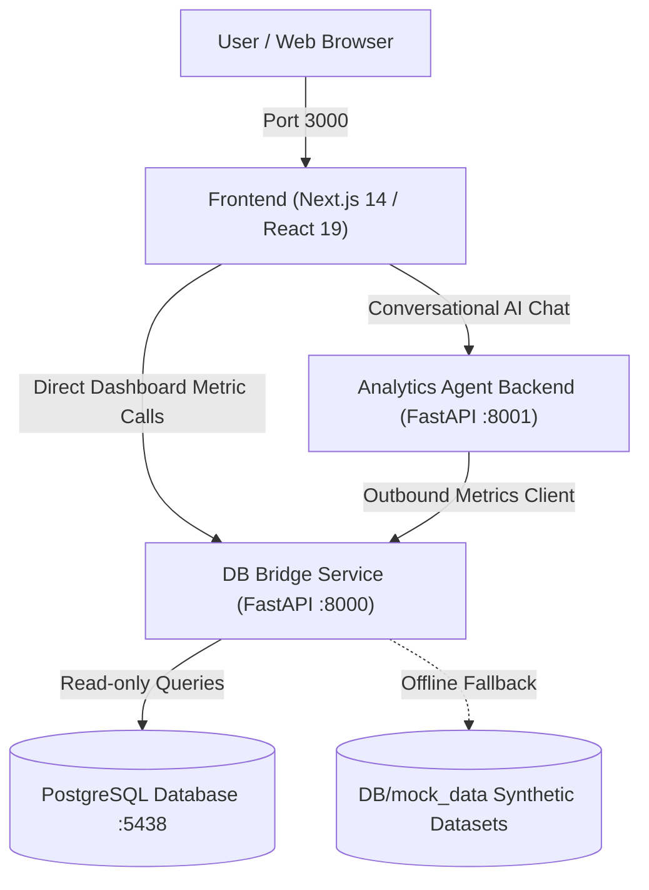

# Course Intelligence & Analytics Agent Platform

A production-ready full-stack analytical intelligence platform combining deterministic database metrics with conversational AI. The repository is partitioned into four modular, decoupled architectural tiers:

1. **`frontend/`** : Next.js 14 / React 19 analytics dashboard and conversational chat UI (Port 3000).
2. **`backend/`** : Analytics Agent FastAPI backend handling natural-language intent parsing, deterministic comparisons, and LLM explanations (Port 8001).
3. **`bridge/`** : DB Bridge FastAPI service providing read-only PostgreSQL querying, metric calculations, in-memory caching, and mock fallback (Port 8000).
4. **`DB/`** : Database layer containing SQL schema definitions, synthetic mock datasets, profiling outputs, and validation rules.

---

## Architecture & Data Flow



```text
┌─────────────────────────────────────────────────────────────┐
│                         FRONTEND                            │
│  (Next.js 14, React 19, Recharts, TypeScript — Port 3000)    │
└──────────────┬──────────────────────────────┬───────────────┘
               │                              │
         Direct Dashboard              Conversational
           Metric Calls                  User Chat
               │                              │
               │               ┌──────────────▼──────────────┐
               │               │           BACKEND           │
               │               │ (FastAPI, LLM — Port 8001)  │
               │               └──────────────┬──────────────┘
               │                              │
               │                    Outbound HTTP Client
               │                              │
               └──────────────┬───────────────┘
                              │
               ┌──────────────▼──────────────┐
               │           BRIDGE            │
               │  (FastAPI Cache/Repo — 8000)│
               └──────────────┬──────────────┘
                              │
               ┌──────────────▼──────────────┐
               │             DB              │
               │ (PostgreSQL 127.0.0.1:5438  │
               │   or DB/mock_data fallback) │
               └─────────────────────────────┘
```

---

## Directory Structure

```text
Analytics-Agent/
│
├── frontend/                  # Tier 1: Next.js 14 Web Application
│   ├── src/
│   │   ├── app/               # Next.js App Router (page.tsx, layout.tsx)
│   │   ├── chat/              # Chat UI components & message history
│   │   ├── dashboard/         # Dashboard metrics, charts, & comparison tables
│   │   ├── components/        # Header and shared navigation
│   │   └── lib/               # Environment & helper utilities
│   ├── package.json           # Frontend dependencies & npm scripts
│   ├── tsconfig.json          # TypeScript compiler configuration
│   ├── vitest.config.ts       # Vitest unit testing configuration
│   └── README.md              # Frontend documentation & guides
│
├── backend/                   # Tier 2: Analytics Agent AI Backend
│   ├── app/
│   │   ├── agent/             # Intent planner, prompt templates, & metric tools
│   │   ├── analysis/          # Deterministic Python comparison logic
│   │   ├── api/               # FastAPI chat route (POST /api/chat)
│   │   ├── clients/           # HTTP metrics client querying port 8000
│   │   ├── schemas/           # Pydantic models for chat requests & responses
│   │   ├── config.py          # Backend settings and OpenAI model config
│   │   └── main.py            # FastAPI backend application entrypoint
│   ├── tests/                 # 39 Pytest backend unit tests
│   ├── requirements.txt       # Backend Python dependencies
│   └── README.md              # Backend documentation & guides
│
├── bridge/                    # Tier 3: DB Bridge Service
│   ├── app/
│   │   ├── api/               # Metrics & database health routers
│   │   ├── repositories/      # Database & Mock Analytical repositories
│   │   ├── cleaning/          # Data cleaning and business eligibility rules
│   │   ├── features/          # Feature extraction logic
│   │   ├── profiling/         # Profiler queries, schemas, and reports
│   │   ├── services/          # Caching & metric business services
│   │   ├── config.py          # Database URL & bridge configuration
│   │   ├── database.py        # SQLAlchemy read-only engine & sessions
│   │   └── main.py            # FastAPI bridge application entrypoint
│   ├── tests/                 # 78 Pytest bridge tests
│   ├── requirements.txt       # Bridge Python dependencies
│   └── README.md              # Bridge documentation & guides
│
├── DB/                        # Tier 4: Database Layer & Data Intelligence
│   ├── mock_data/             # Synthetic JSON datasets (offline fallback)
│   │   ├── monthly_bookings.json
│   │   ├── course_monthly_bookings.json
│   │   └── monthly_conversations.json
│   ├── profiling/output/      # Generated database profile (database_profile.json)
│   ├── analytics/output/      # Precomputed aggregate datasets
│   ├── docs/                  # Cleaning rules & metric validation documentation
│   ├── init_schema.sql        # Full PostgreSQL DDL (golf_courses, bookings, conversations)
│   ├── check_db.py            # Standalone database connectivity diagnostic script
│   └── README.md              # Database documentation & setup guide
│
├── docs/                      # Architectural specifications & session audit reports
├── scratch/                   # Performance benchmarks and experimental scripts
├── run.py                     # Master development CLI runner
├── Makefile                   # Make target runner
├── make.bat                   # Windows batch shortcut
├── make.ps1                   # Windows PowerShell shortcut
└── .gitignore                 # Root git ignore specification
```

---

## Port Allocation

| Component | Port | Description |
| :--- | :--- | :--- |
| **Frontend UI** | `3000` | Next.js / React Web Application |
| **Backend Agent** | `8001` | FastAPI Analytics AI Agent |
| **DB Bridge** | `8000` | FastAPI Metrics & DB Bridge Service |
| **PostgreSQL DB** | `5438` | Target PostgreSQL Database (via SSH tunnel or local) |

---

## Quick Start: How to Run Every Component

### 1. Initial Setup & Installation
Install all Python virtualenv dependencies and Frontend npm packages:
```powershell
# Create .venv and install Python dependencies for both backend & bridge:
python run.py install

# Install frontend npm dependencies:
cd frontend
npm install
cd ..
```

---

### 2. Running Services

Open three terminal windows to run all three services concurrently:

#### Terminal 1 — DB Bridge (Port 8000)
The DB Bridge must start first so backend and frontend can consume metrics.
```powershell
python run.py run-bridge
# Or directly:
# uvicorn app.main:app --reload --host 127.0.0.1 --port 8000 --app-dir bridge
```
*Health check:* Visit `http://127.0.0.1:8000/health` or `http://127.0.0.1:8000/api/metrics/overview`.

#### Terminal 2 — Analytics Agent Backend (Port 8001)
```powershell
python run.py run-backend
# Or directly:
# uvicorn app.main:app --reload --host 127.0.0.1 --port 8001 --app-dir backend
```
*Health check:* Send a POST request to `http://127.0.0.1:8001/api/chat`:
```bash
curl -X POST http://127.0.0.1:8001/api/chat -H "Content-Type: application/json" -d '{"message": "How did bookings change this month?"}'
```

#### Terminal 3 — Frontend Web UI (Port 3000)
```powershell
python run.py run-frontend
# Or directly:
# cd frontend && npm run dev
```
*Open application:* Visit `http://localhost:3000` in your web browser.

---

### 3. Database Operations & Diagnostics

#### Test Database Connectivity
Check whether your live PostgreSQL database/tunnel is active or if the system will use mock data:
```powershell
python run.py check-db
# Or directly:
# python DB/check_db.py
```

#### Deploy / Verify Database Schema
```bash
psql -h 127.0.0.1 -p 5432 -U postgres -d courserev_prod -f DB/init_schema.sql
```

#### Run Database Profiler
```powershell
python run.py profile
```

#### Build Analytical Aggregates
```powershell
python run.py analytics
```

---

### 4. Running Tests

#### Run Backend Tests (39 tests)
```powershell
python run.py test-backend
```

#### Run DB Bridge Tests (78 tests)
```powershell
python run.py test-bridge
```

#### Run Frontend Tests (20 tests)
```powershell
python run.py test-frontend
```

#### Run All Test Suites
```powershell
python run.py test-all
```

---

## Environment Variables Configuration

| Tier | File | Key Variables | Description |
| :--- | :--- | :--- | :--- |
| **Frontend** | `frontend/.env` | `NEXT_PUBLIC_AGENT_API_URL=http://localhost:8001`<br>`NEXT_PUBLIC_METRICS_API_URL=http://localhost:8000` | Points UI to backend and bridge services |
| **Backend** | `backend/.env` | `METRICS_API_URL=http://localhost:8000`<br>`OPENAI_API_KEY=sk-...`<br>`OPENAI_MODEL=gpt-4o-mini` | Points agent to bridge and configures LLM |
| **Bridge** | `bridge/.env` | `DATABASE_URL=postgresql+psycopg://...`<br>`APP_ENV=development` | Read-only connection string to PostgreSQL |

